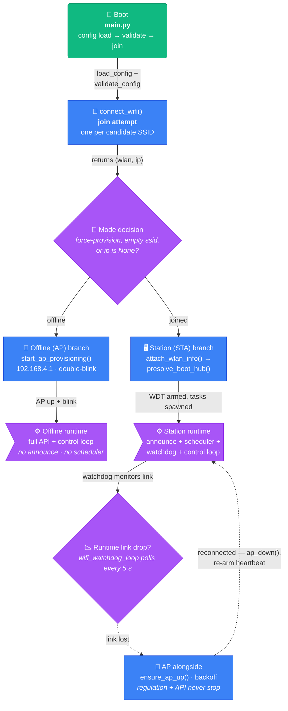
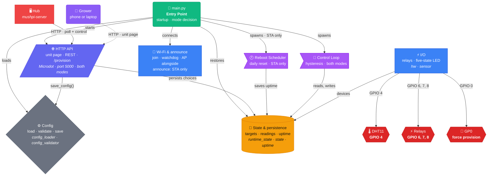

This page maps the inside of `mushpi-grow` — the MicroPython firmware running on the Raspberry Pi Pico 2W. It starts with how a unit runs in each operating mode, then walks the entry point, the Wi-Fi lifecycle, the REST API, the hysteresis control loop, the shared state and its durable runtime-state store, and the hardware it drives.

## Operating Modes

The firmware does the same job in every configuration — sample the DHT11, run the hysteresis loop, serve the REST API on port 5000 — and only the *hub interaction* changes. The grower-facing picture is [How a Pico Unit Runs](/pico-units/index); the internals below. There are three ways a unit runs, and at the firmware level they differ only in **announce and hub interaction, never in control**:

1. **No Wi-Fi** — `wifi.ssid` is empty (factory default) or a join failed. The unit runs its own open access point and regulates there.
2. **Wi-Fi without a hub** — `hub_url` is empty. The unit joins a network and regulates; announce is skipped (`announce: skipped (hub_url not configured)`), so a standalone unit simply never announces.
3. **Wi-Fi with a hub** — `hub_url` is set. Announce, the reboot scheduler and the link watchdog run; the hub polls and proxies control.

**Offline (AP) mode is a normal operating state, not a fallback.** A unit with no usable Wi-Fi link is not a unit that failed to reach its hub — it is a unit running in its offline mode, with the *full* API and the *full* control loop. Two things bring the access point up:



- **At boot** — after `connect_wifi()` fails (or is skipped because `wifi.ssid` is empty, or GP0 forces provisioning), `start_ap_provisioning()` brings up the open AP at `192.168.4.1` and the unit starts the control loop and the REST API there. It no longer idles waiting for credentials.
- **At runtime** — a link drop does not switch modes: `wifi_watchdog_loop()` keeps the unit in its boot mode and raises the AP *alongside* it (`ensure_ap_up()`) while reconnecting with backoff, so the page stays reachable. Regulation and the REST API never stop.

The AP stays up **indefinitely** (until credentials are provisioned, or a watchdog-recovered STA link drops it again) and is **open — deliberately password-free**: the offline network is short-range and unit-local. Rejoin is restart-based: `POST /provision` writes `config.json` and reboots into STA, and there is no background STA rejoin task offline.

**The control loop runs in both modes.** It is driven by the persisted targets, never by the hub — the hub is never in the loop that drives the relays, and an unreachable hub, an unresolvable hub name, or a hub that accepts and then stays silent can therefore never stop regulation. Offline, the loop also carries the offline-only sensor-fault output cut (see the [Control Loop](#module-responsibilities) row).

The grower-facing walkthroughs live in [Offline operation](/pico-units/offline-operation) (joining the AP, setting up Wi-Fi, force-provision) and [How a Pico Unit Runs](/pico-units/index).



## Module Responsibilities

| Module | File | Responsibilities |
|--------|------|-----------------|
| **Entry Point** | `main.py` | Wires everything together. Sequence: IO init → DHT init → load config → validate → check GP0 force-provision (and empty-ssid) → `connect_wifi()` join attempt → mode decision → AP branch (raise AP, blink) or STA branch (`attach_wlan_info()` caches MAC/IP/hostname/port, `presolve_boot_hub()`) → `runtime_state.restore()` → arm the 8 s watchdog → spawn per-branch tasks → `start_server()`. The `finally` block calls `graceful_shutdown()` to turn outputs off and disconnect Wi-Fi. |
| **API Server** | `app/api.py` | REST API on port 5000 (Microdot). Full REST API in both modes. `GET /` content-negotiates — the unit page for a browser, the JSON snapshot for an API client, in both modes; `GET /ui` is an alias; `GET /provision` serves the Wi-Fi setup form (both modes), `POST /provision` is offline-only (refused `403` on a connected unit). CORS headers on all responses. |
| **Control Loop** | `app/control.py` | Async coroutine (`control_loop()`, runs in both modes, offline included) — driven by the persisted targets, never by the hub: the hub is never in the loop that drives the relays. Every `period_s` seconds it samples the DHT11 and drives the relays by hysteresis (deadbanded; see [hysteresis control](/configuration/hysteresis-control)). Owns control enablement as an `asyncio.Event` (not shared state) and min-runtime tracking via `mark_relay_on()` / `mark_relay_off()` / `reset_on_since()`. Offline only, `main.py` wires `sensor_fault_cut=True`: when the last plausible reading is older than `_SENSOR_STALE_CUT_S` (120 s) the loop holds the outputs off (relays off + `reset_on_since()` each pass, no actuation) until a fresh plausible reading lands — no hub is watching the readings offline. |
| **DHT Reader** | `app/sensor.py` | Reads DHT11. Validates plausibility (-10°C ≤ t ≤ 60°C, 0% ≤ h ≤ 100%). Updates shared `status` dict. Supports `?force=1` for on-demand measurement. |
| **IO Layer** | `app/hw.py` | Initializes all GPIO pins. Toggles relays (respects `active_high` config). Manages the onboard LED — five states, corrected: **SLOW DOUBLE-BLINK** = working with no usable Wi-Fi link (no network, failed join, force-provision, runtime link drop) — *not* a fault; **SOLID** = connected but hub announcement pending/unacknowledged (includes a standalone no-hub unit); **HEARTBEAT** = acknowledged by the hub; **CONFIG ERROR** = terminal; **OFF** = boot-time Wi-Fi attempts only. See [Reading the Status LED](/pico-units/status-indicators). Reads GP0 at boot for force-provision. |
| **Wi-Fi Lifecycle** | `app/wifi.py` | Owns every Wi-Fi state transition: `connect_wifi()` (blocking boot connect), `reconnect_once_async()` (async runtime reconnect), `ensure_ap_up()`/`ap_down()` (AP lifecycle, one code path shared by boot and runtime), and `wifi_watchdog_loop()` (link monitor, polls every 5 s: on a link drop it raises the AP *alongside* the still-regulating unit and reconnects with backoff 5/10/30/60 s; its reconnection does not re-announce and does not re-resolve the hub). |
| **Announce** | `app/announce.py` | POSTs device info to the server's `POST /v1/pico-units/announce`. Spawned once at boot; on failure it retries forever in the background with backoff — 30 s, 30 s, 60 s, 120 s, then capped at 300 s — until accepted. Each attempt is bounded (~3 s connect ceiling, 1 s IO slices, ~6 s response-wait) and yields between slices. The payload includes the `mac` field (lowercase colon-separated hex, e.g. `"28:cd:c1:01:23:45"`), sourced from cached `system['wifi']['mac']` populated during `attach_wlan_info()`, plus `firmware_version` (from `_SOFTWARE_VERSION`) and `api_version` (from `_API_VERSION`). The retry path never re-resolves the hub name. Skipped in AP mode, and skipped when `hub_url` is empty — a standalone no-hub unit simply never announces. |
| **Shutdown** | `app/shutdown.py` | `graceful_shutdown()` (turns all outputs off, disconnects Wi-Fi), `reboot()`, `soft_reboot()`, and the shared `stop_event` that long-running loops check to exit cleanly. |
| **Metrics** | `app/metrics.py` | Provides system snapshot: free RAM, filesystem free blocks, WiFi RSSI, MCU temperature, uptime, event loop utilization percentage. |
| **Config Loader** | `app/config_loader.py` | `load_config()`: loads `config.json` with shallow merge over hardcoded defaults. `save_config()`: atomic write via `config.json.tmp` + `os.rename` — used by `POST /provision`. |
| **Config Validator** | `app/config_validator.py` | Boot-time validation of all config fields: types, ranges, required keys, plus the **terminal boot-time duplicate-GPIO rule** — any two roles sharing a GPIO in the effective (default-merged) `pins` map is a fatal configuration error that starts no services (there is no live mapping at boot to merge against). This is distinct from `POST /setup`'s request-scoped merged-view rule (see [Pin remapping](#pin-remapping)). Accumulates all errors and prints human-readable messages. On failure, triggers terminal `error_blink_blocking()` LED pattern. |
| **Uptime Tracker** | `app/uptime.py` | Cumulative uptime across scheduled reboots. Classifies reboot reason via `machine.reset_cause()` (`PWRON_RESET` → power_on, `WDT_RESET` → watchdog, `SOFT_RESET` → scheduled). Persists cumulative uptime + date guard to `uptime.json`. |
| **Runtime State** | `app/runtime_state.py` | Owns the device-local store of grower-chosen runtime state, persisted to `runtime.json`: the temperature/humidity **targets**, the **control-loop on/off flag**, and the hand-set **fan** and **humidifier** positions. Written by the three `POST` handlers (`/setpoints`, `/outputs`, `/control`) when the grower acts; restored once at boot via `restore()` so those choices survive a restart — a power cut included, and they apply offline because the offline mode runs the same control loop. The **heater is deliberately not stored** and always returns off. |
| **Reboot Scheduler** | `app/reboot_scheduler.py` | Async coroutine (STA only — not spawned offline). Syncs NTP after Wi-Fi connect, then polls every 60 s and triggers `machine.soft_reset()` at the configured hour/minute (disabled by default). The schedule is gated on a landed sync: with no NTP sync landed no date is observed, so an unreachable or unresolvable `ntp_host` means *no scheduled reboot*, not a wrong one. Guards against double-reboot via a date sentinel. |
| **Provisioning HTML** | `app/provision.html` | Dark-themed HTML form served at `GET /provision` in both modes — offline it submits; on a connected unit the form loads but its submission is refused `403`. Matches the MushPi React frontend's visual identity. Accepts SSID and password, submits to `POST /provision`. |
| **Shared State** | `app/state.py` | Exports mutable dictionaries (`status`, `setpoints`, `devices`) and cached `_system_info` (incl. `wifi.mac`, `wifi.ip`, board metadata). Mutate in place — never reassign. `attach_wlan_info()` populates Wi-Fi MAC, IP, and hostname from the active WLAN interface. Control enablement is *not* state — it is an `asyncio.Event` owned by `app/control.py`. |

## Pin remapping offline

`GET/POST /setup` works in AP mode with the **same validation** as when connected — pin remapping is offered in both modes, and a change persists to `config.json` (`pins`, `active_high`) across reboot. The offline page posts `/setup` same-origin straight to the unit, so the hub's setup-proxy `422` pre-check never protected that path; the firmware's own validation stands alone.

There are **two distinct duplicate-GPIO rules**, and they are deliberately not unified:

1. **Request-scoped merged-view rule** (shared by the firmware, `mushpi-mock` and the server's `422` setup-proxy pre-check). A `POST /setup` is rejected only when it would leave two functions on one GPIO *after merging the partial update with the current mapping* — re-assigning a device to the pin it already holds, and a pin freed by another device within the same request, are allowed; only conflicts the request creates or perpetuates are refused.
2. **Terminal boot-time rule** (firmware-only, in `validate_config()` / `_append_duplicate_gpio_errors`). Any two roles sharing a GPIO in the effective (default-merged) `config.json` map is a **fatal** configuration error that starts no services — the unit prints the conflicting GPIO and roles, holds the outputs off, and stays in the error state until a corrected `config.json` is flashed. There is no live mapping at boot to merge against, so the request-scoped allowances do not apply.

`POST /setup` finally runs the boot rule itself over the request-merged map, so a mapping the endpoint accepts is one the unit would also boot with — an endpoint-internal guarantee, not a unification. The how-to is on [Offline operation](/pico-units/offline-operation).

## Startup Sequence

~~~
IO() → DHTReader() → load_config() → validate_config()
→ init_uptime() → init_system_info()
→ check GP0 (force-provision pin) + empty-ssid check
→ connect_wifi() (join attempt — retries each candidate SSID)
    ├── SUCCESS (joined) → attach_wlan_info()  ← caches MAC, IP, hostname, port
    │   → presolve_boot_hub()         ← resolves the hub address on the boot path,
    │                                   the only name lookup the firmware ever runs,
    │                                   before the watchdog exists (skipped when
    │                                   hub_url is empty)
    └── OFFLINE (force-provision, empty ssid, or ip is None)
        → start_ap_provisioning()     ← open AP at 192.168.4.1, stays up indefinitely
        → io.start_provisioning_blink()

→ restore saved state (both modes)   ← runtime_state.restore(): reapplies the grower's
                                       targets, loop flag, and (loop off) hand-set
                                       fan/humidifier — offline included
→ spawn loop-utilisation meter
→ arm the 8 s watchdog               ← armed before the control-loop tasks; offline
                                       units are not exempt
    ├── STA → spawn reboot_scheduler_loop() (STA)
    │       → spawn announce (STA)    ← spawned once, retries forever with backoff
    │                                   until accepted; skipped when hub_url is empty
    │       → spawn control_loop()
    │       → spawn wifi_watchdog_loop()
    │       → await start_server("sta")
    └── AP  → spawn control_loop(sensor_fault_cut=True)  ← full control loop, offline
            → await start_server("ap") ← full API + unit page + GET /provision form
            (no announce, no reboot scheduler, no link watchdog, no NTP)
~~~

The announce is a background coroutine, never a boot gate: it is spawned once at boot and runs alongside the control loop and the REST API, not before them. The hub address is resolved exactly once, on the boot path (`presolve_boot_hub()`), before the watchdog is armed — and never again at runtime: the retry path deliberately never looks a name up. Two accepted trades follow: a hub whose address changes is only picked up at the next boot, and if the boot-time lookup fails the unit logs that no hub address is available and keeps retrying rather than resolving. The announce task retries forever, backing off — 30 s, 30 s, 60 s, 120 s, then capped at 300 s — until the hub accepts. Each attempt is bounded and sliced — a 3 s connect ceiling, about 6 s of response-waiting in 1 s IO slices, yielding between slices — and is traced to the console (attempt number, elapsed ms and status); a failed lookup prints a no-hub-address line. The hardware watchdog is armed at boot, before the control-loop, announce and Wi-Fi tasks are created (the loop-utilisation meter is scheduled just before that line — incidental). An unreachable hub, an unresolvable hub name, or a hub that accepts and then stays silent can therefore never reset the unit, and none of them stops regulation or the REST API: the 8 s window applies only to genuine hangs once the unit is running. A Wi-Fi link bounce triggers no re-announce: the forever-retry task carries the unit's new IP on its next attempt, and the hub's own 60-second poll refreshes an already-known unit's stored IP independently.

## REST API

| Method | Path | Purpose |
|--------|------|---------|
| GET | `/` | Unit page for a browser, JSON full snapshot for an API client — in both modes. Content negotiation: an `Accept` containing `text/html` and not `application/json` gets the page; everything else gets JSON (system + firmware/api version + health + sensors + outputs + setpoints + control). |
| GET | `/ui` | Alias for the unit status-and-control page (text/html, both modes). |
| GET | `/ping` | Liveness check |
| GET | `/health` | RAM, FS, WiFi RSSI, MCU temp, uptime, loop util |
| GET | `/system` | Board info, MicroPython version, WiFi IP/MAC |
| GET/POST | `/sensors` | DHT11 reading; `?force=1` triggers on-demand |
| GET/POST | `/setpoints` | `{"temperature": int, "humidity": int}` — accepted and persisted offline |
| GET/POST | `/outputs` | `{"fan": bool, "humidifier": bool, "heater": bool}` — accepted and persisted offline (heater never persists) |
| GET/POST | `/control` | `{"enabled": bool}` — toggles control loop; accepted and persisted offline |
| GET/POST | `/setup` | GPIO pin remapping + `active_high` polarity — accepted offline with the same validation |
| POST | `/reboot` | Graceful reboot. Body `type` = `"soft"` or `"hard"` (optional, default `soft`). Response returns before reboot. |
| POST | `/provision` | Wi-Fi provisioning (offline/AP mode only). `{"wifi":{"ssid":"...","password":"..."}}` → writes config.json + reboots; refused `403` on a connected unit. |

## Announce Payload

The announce POST (`POST /v1/pico-units/announce`) carries the unit's identity, version metadata, and board metadata. Its canonical shape is documented in `mushpi-grow/spec/openapi.yaml` → `components.schemas.AnnouncePayload` (11 fields, only `handle` required):

```json
{
  "handle": "pico-unit1",
  "ip": "192.168.1.50",
  "mac": "28:cd:c1:01:23:45",
  "port": 5000,
  "micropython_version": "<micropython build string>",
  "firmware_version": "0.8.4",
  "api_version": 1,
  "board": "Raspberry Pi Pico W with RP2040"
}
```

- `firmware_version` is the SemVer from `_SOFTWARE_VERSION` (the single source of truth is `app/state.py`); `api_version` is the Pico↔Server contract generation from `_API_VERSION`. Both are also returned at the top level of `GET /`.
- `mac` is sourced from the cached `system['wifi']['mac']` dict populated during `attach_wlan_info()` at boot; format is lowercase colon-separated hex (e.g. `"28:cd:c1:01:23:45"`). This allows the server to derive the provisioning AP SSID (`mushpi-provision-{last4hex}`) for offline reconnection guidance.
- The remaining `board_total_mem_byte`, `board_total_fs_byte`, and `board_cpu_freq_mhz` fields are the runtime memory/filesystem/CPU snapshot from `health`/`system`.

## LED Status Indicators

The onboard LED (driven by `app/hw.py`) reports the unit's state through five patterns. The grower-facing reading is [Reading the Status LED](/pico-units/status-indicators); the firmware semantics are:

| Pattern | Firmware meaning |
|---|---|
| **SLOW DOUBLE-BLINK** | The unit is **working** — regulating and serving its page — but has **no usable Wi-Fi link**: no network configured, a failed join, a force-provision boot, or a runtime link drop (during which it raises its own AP). **Not a fault**, and not provisioning-only. |
| **SOLID** | Wi-Fi connected, but the hub announcement is pending or not yet acknowledged — including a standalone no-hub unit (`hub_url` empty), which never leaves solid. |
| **HEARTBEAT** (even blink) | Acknowledged by the hub — healthy operation *within a hub*. |
| **CONFIG ERROR** (3 fast blinks) | Terminal — `config.json` is malformed or assigns one GPIO to two roles; no services start. |
| **OFF** | Boot-time Wi-Fi attempts only — the LED stays off while `connect_wifi()` works through the candidate list. A runtime link drop is the double-blink, not OFF. |
