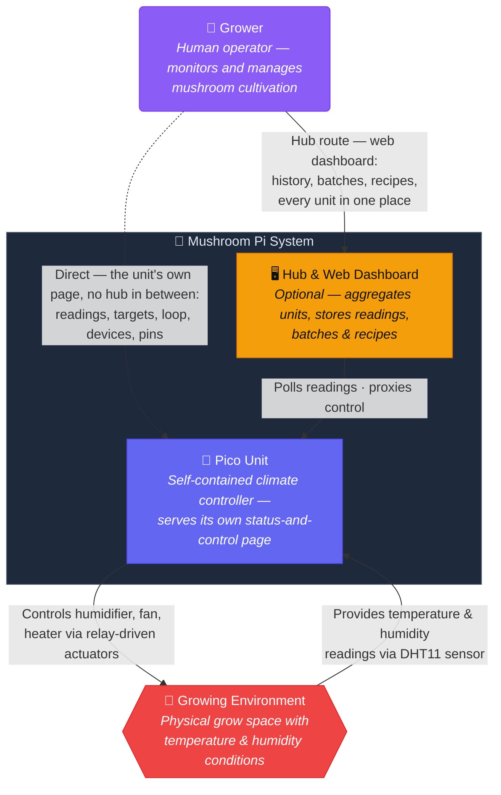

## Narrative

The Mushroom Pi system automates climate control for mushroom cultivation. A **grower** reaches it two ways. Through the **hub's web dashboard** — the hub route — they monitor conditions, browse reading history, set temperature/humidity targets, and manage batches and recipes across every unit. Directly, through **each unit's own status-and-control page**, they read that unit's live climate readings and relay states, set its target temperature and humidity, toggle its control loop, hand-switch the humidifier, fan and heater, remap its GPIO pins, and reboot it — all served by the unit itself, with no hub in between.

Each unit reads environmental data (temperature, humidity) from a DHT11 sensor and controls three actuators — a humidifier, a fan, and a heating mat — via relay switches running a hysteresis-based control loop. The hub is never in that loop: it polls each unit for readings and proxies control changes, but the unit decides and actuates on its own.

Multiple Pico 2W units can be deployed, each controlling its own growing environment — and each works standalone, with no hub at all. The central server polls each unit, stores historical readings, and serves the data to the dashboard.

### External systems

- **Growing Environment**: The physical space. Not a software system — it's the real-world conditions the sensors measure and the actuators affect.
- **Grower**: The human operator. Reaches the system two ways — the hub's web dashboard (history, batches, recipes), and each unit's own page directly (live readings, targets, loop, devices, pins). Neither route requires the other: a unit's page works with no hub configured.
