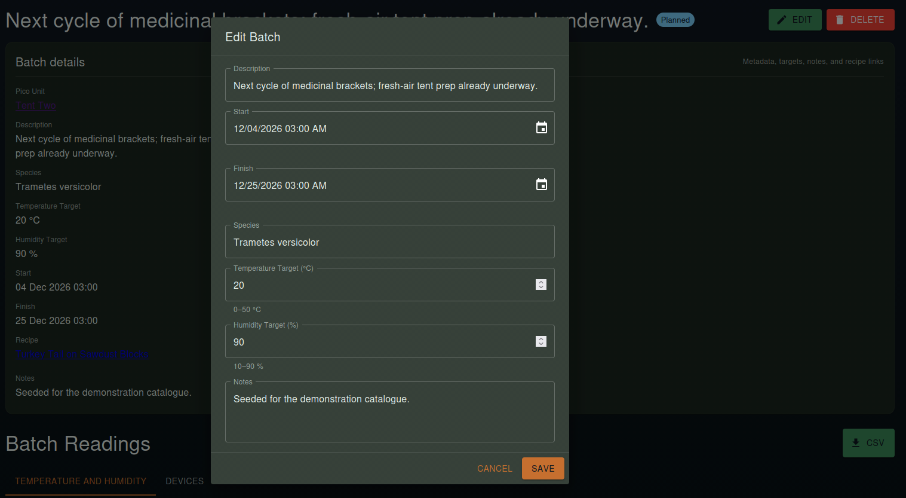
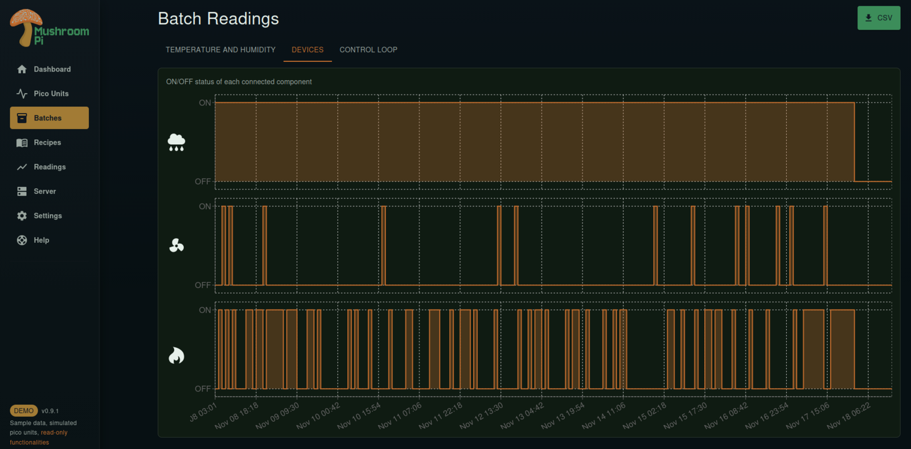

This is step 4 of a grow. Finishing a batch closes the loop: the grow becomes part of your history, and a good grow can become a reusable recipe.

## Set the finish date

A batch becomes **Finished** when its **Finish** date passes — you do not mark it complete with a button. To finish a batch on your schedule:

1. Open the batch from the Batches list.
2. Click **Edit**.
3. Set the **Finish** field to when the grow ends.
4. Click **Save**.

If the batch was created with a recipe, its **Finish** field was already filled in from the recipe's duration when you started it. Setting or changing it here is all that is needed.

*The Edit Batch dialog, where the Finish date is set (Mushroom Pi 0.9.1).*

## What changes when a batch is Finished

- The batch's status becomes **Finished**, and it drops out of the active-batch view.
- The Dashboard moves it into **Recently finished**.
- The batch's readings stay available — the three chart tabs and the readings export keep working for the batch's full date range.
- The unit is free to start the next batch.

## Save as Recipe

If a grow went well and you want to repeat it, turn the finished batch into a recipe. On a **Finished** batch's page, use **Save as Recipe**. The new recipe takes the batch's species and temperature and humidity targets, and its duration is worked out from the batch's start and finish dates. The recipe then appears in the Recipes list, ready to attach to your next batch.

**Save as Recipe** is available on finished batches only — a grow has to be complete before it can be distilled into a reusable recipe.

*A finished batch's page — the Finished badge and the Save as Recipe button (Mushroom Pi 0.9.1).*

## Export a batch's readings

On the batch's page you can download its readings as a CSV file, the same way as on the Readings page. This gives you a record of the grow's temperature and humidity, device state, and control-loop state across its whole run.

*A batch's readings — the Devices tab and the CSV export button (Mushroom Pi 0.9.1).*
