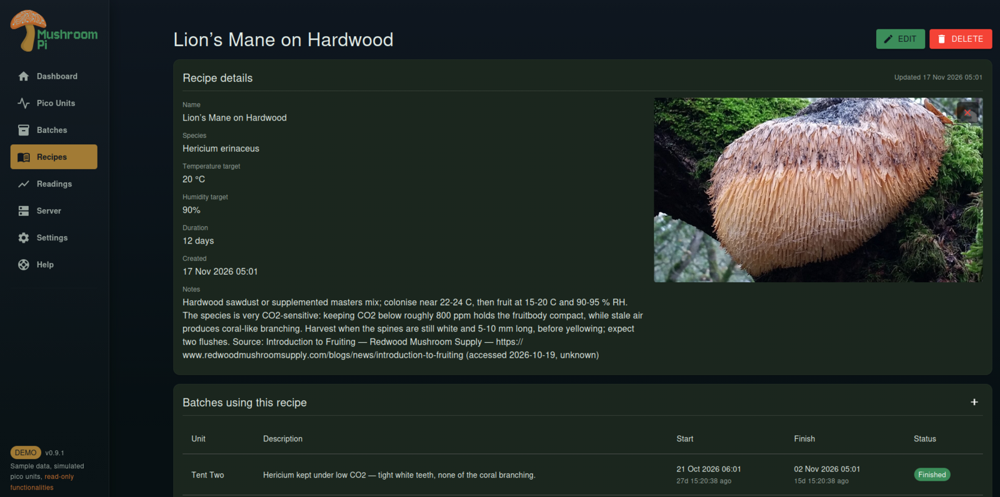
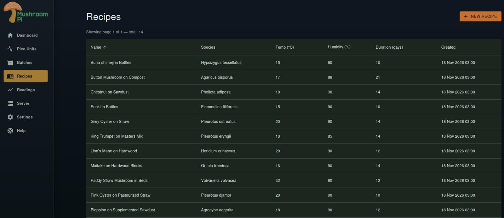
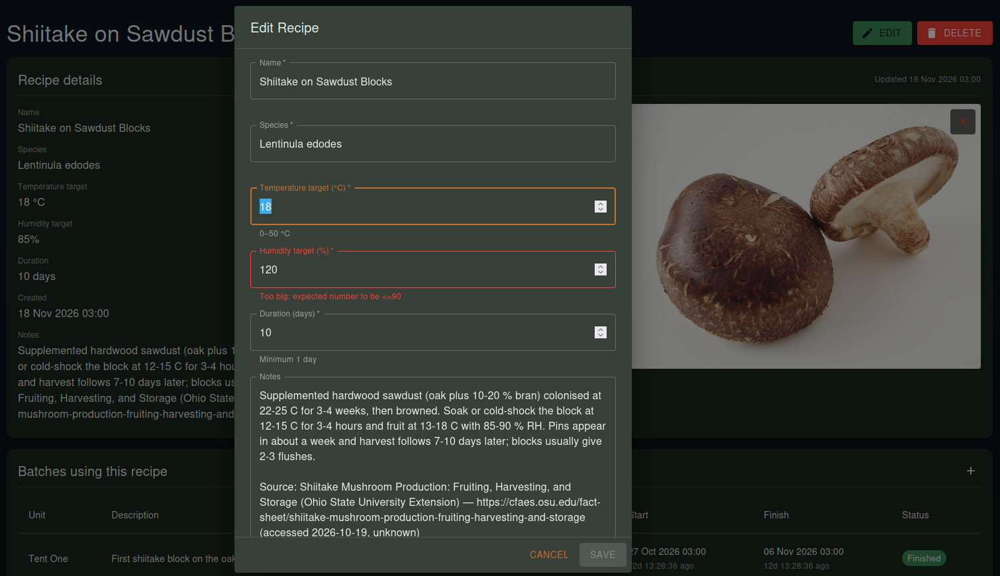

This is step 1 of a grow. A **recipe** stores the climate targets for a species — the temperature and humidity you want to hold — so you set them once and reuse them on every batch of that species. A recipe does nothing on its own; it takes effect when you attach it to a batch.

Mushroom Pi ships with **no pre-loaded recipes**. Every recipe in your list is one you create, so the list stays relevant to what you actually grow.

## What a recipe contains

| Field | What it is |
|---|---|
| **Name** | A label so you can pick the recipe out of a list later |
| **Species** | What the recipe is for |
| **Temperature target (°C)** | The temperature the unit's control loop aims to hold |
| **Humidity target (%)** | The relative humidity the loop aims to hold |
| **Duration (days)** | How long a batch using this recipe should run |
| **Notes** | Free text, optional |
| **Image** | One optional photo |

*A recipe's detail page — its targets and the batches using it (Mushroom Pi 0.9.1).*

The **temperature target** and **humidity target** are the values the Pico unit's control loop tries to maintain: the loop switches the heater, fan and humidifier on and off to keep conditions close to them. How tightly it holds them — how far conditions may drift before the loop acts — is explained in [Hysteresis control](/pico-units/hysteresis-control).

The targets are bounded: **0–50 °C** for temperature and **10–90 %** for humidity. A value outside that range is rejected until it is corrected.

The **duration** matters when you start a batch: it is used to work out the batch's finish date.

## Create a recipe

1. Click **Recipes** in the sidebar.
2. Click **New Recipe** in the top-right of the page.
3. Fill in **Name**, **Species**, **Temperature target (°C)**, **Humidity target (%)** and **Duration (days)**. Add **Notes** and an **Image** if you want them.
4. Click **Save**.

The recipe now appears in the Recipes list, and in the **Recipe** dropdown when you create a batch.

*The Recipes list — name, species, targets, duration and created date (Mushroom Pi 0.9.1).*

## Edit or delete a recipe

Open a recipe from the list to see its targets, its duration, and the batches that use it. From there you can **Edit** it or **Delete** it. Changing a recipe affects only that recipe — batches that were created from it keep their own copy of the targets, so an existing grow does not change underneath you.

*Editing a recipe: a humidity target above 90 % is rejected until it is back in the 10–90 % range (Mushroom Pi 0.9.1).*

Open the [public demo](https://mushroom-pi.demo.amda.dev/) to see the dashboard live, populated with sample data.
