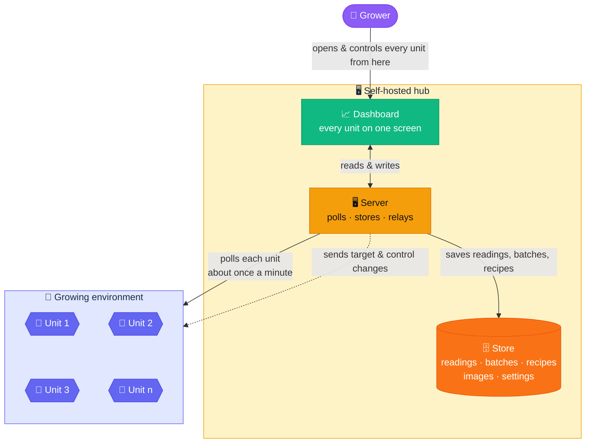

The **dashboard** is the website the self-hosted hub serves. Open it in a browser on your local network and you get one screen for every growing unit you have, plus reading history, batches and recipes — all running on your own hardware, with no cloud account and no subscription. It is the instrument you run a grow with; the step-by-step walkthrough is [Start here](/dashboard/index), and the hub's deployment is [Self-hosting](/deployment/self-hosting).

*Several units report to one hub. The hub saves their readings and gives you one place to control them all — while each unit keeps regulating on its own.*

## Which units it shows

The dashboard shows every **Pico unit** that has registered with the hub, side by side, each with its own health, last reading and active batch. The dashboard *reflects* the units — it never runs them. Each unit keeps regulating from the targets it holds, whether or not the dashboard can reach it; the dashboard just shows you the result and lets you reach in and change a unit from one place.

A unit is not only visible through the dashboard: each Pico also serves its **own page** directly, with no hub in between. The dashboard's unit detail is a view *of* the unit rendered by the server; the unit's own page is the unit's *own* view of itself. The distinction is on [The unit's own page](/pico-units/unit-page).

## What it stores

The hub keeps four kinds of thing in a local store on your own hardware:

- **Readings** — every poll of every unit is saved, charted over time and exportable as CSV.
- **Batches** — your grow runs.
- **Recipes** — your reusable climate settings.
- **Images** — the photos you attach to batches and recipes, plus the timezone setting.

Units are polled about **once a minute** — a fixed rhythm on the server, not a dashboard setting. How long readings are kept is a server setting too, not a dashboard control; both are covered in [Environment configuration](/deployment/environment).

## Batches, at a high level

A **batch** is one grow on one unit, from a start date to a finish date. You pick the unit, optionally a recipe, and the targets the batch should hold. Its status is worked out from its dates — **Planned**, **In Progress** or **Finished** — not set by a button, and a batch finishes when its finish date arrives. While a batch is in progress, its targets govern the unit, taking over from whatever the unit had saved. The how-to is [Start a batch](/dashboard/batches) and [Finish a batch](/dashboard/finishing-a-batch).

## Recipes, at a high level

A **recipe** stores the climate targets for a species — temperature, humidity and a duration — so you set them once and reuse them on every batch of that species. A recipe does nothing on its own; it takes effect when you attach it to a batch. Mushroom Pi ships with no pre-loaded recipes: every recipe is one you create. The how-to is [Create a recipe](/dashboard/recipes).

## What it does not do

The dashboard's job is to show, store and record — and there are things it deliberately leaves to the units or to you:

- It **never runs the control loop**. Regulation stays on each unit; the hub is never in the path that switches the devices.
- It **does not expose the loop's tuning**. How tightly a unit holds its targets is set on the unit, not in the dashboard — see [How the control loop works](/pico-units/hysteresis-control).
- It **ships no recipes and no history** — a fresh self-hosted hub starts empty, and you build the list.
- It **has no cloud account or subscription**, and it does not reach you away from home by itself: that is a Tailscale step you set up — [Remote access](/deployment/remote-access).
- Its **Settings** screen holds one control, the display timezone; the poll rate and retention live in server configuration.

The dashboard also talks only to the hub, never directly to a unit — every change you make goes through the server and out to the Pico.

## Where to go next

- [Start here](/dashboard/index) — the grow lifecycle, step by step.
- [Your units](/dashboard/pico-units) · [Recipes](/dashboard/recipes) · [Batches](/dashboard/batches) · [Monitoring](/dashboard/monitoring) — the screens themselves.
- [The Server screen](/dashboard/server) — the hub's own health.
- [What a growing unit is](/pico-units/what-a-unit-is) — the other half of the system.
