Draft — not published.

This diagram used to be the main component diagram on [Pico Firmware Components (C4 Level 3)](/architecture/c4-component-grow). It shows every module as its own node, which is closer to a Level 4 view than a Level 3 one, and at that granularity it cannot be made legible in the site's content column: it renders about 5,600 px wide against a ~670 px column.

It is kept for a future page that breaks the firmware down per module, where it can be split into several smaller diagrams. Known issues, if it is reused as-is: two edge labels collide — `Persists grower choices …` lands on the Config Loader node, and the two HTTP edge labels overlap where both edges converge on the API Server node.

```mermaid
flowchart TB
    subgraph GROW["🌱 Pico Firmware (MicroPython, Pico 2W)"]
        direction TB

        MAIN("🚀 main.py<br/><b>Entry Point</b><br/>Startup sequence, mode decision<br/>(WiFi join or AP fallback),<br/>spawns per-branch tasks")

        API[/"🌐 API Server<br/><b>Microdot (port 5000)</b><br/>Full REST API in both modes — sensors,<br/>setpoints, outputs, control, setup,<br/>ping, health, system, reboot.<br/>GET / = unit page (HTML) or JSON<br/>GET /ui alias · GET /provision form"\]

        CONTROL>"🔄 Control Loop<br/><b>app/control.py</b><br/>Hysteresis-based coroutine —<br/>reads sensor, toggles relays;<br/>owns control_enabled (asyncio.Event)<br/>+ min-runtime tracking. Runs in<br/>both modes; offline adds the<br/>sensor-fault output cut (120 s)"]

        SENSOR["🌡️ DHT Reader<br/><b>app/sensor.py</b><br/>Reads DHT11, validates<br/>plausibility, updates shared state"]

        HW["⚡ IO Layer<br/><b>app/hw.py</b><br/>GPIO init, relay control,<br/>five-state LED (OFF, SOLID, HEARTBEAT,<br/>SLOW DOUBLE-BLINK, CONFIG ERROR)"]

        WIFI["📶 Wi-Fi Lifecycle<br/><b>app/wifi.py</b><br/>connect_wifi() (boot),<br/>reconnect_once_async() (runtime),<br/>wifi_watchdog_loop() (link monitor:<br/>on drop raises the AP alongside,<br/>reconnect backoff)"]

        ANNOUNCE["📢 Announce<br/><b>app/announce.py</b><br/>POSTs device presence to server<br/>(incl. MAC + version metadata),<br/>spawned once at boot, retries forever<br/>with backoff until accepted (STA only;<br/>skipped when hub_url is empty)"]

        SHUTDOWN["🛑 Shutdown<br/><b>app/shutdown.py</b><br/>graceful_shutdown(),<br/>reboot(), soft_reboot(),<br/>stop_event"]

        METRICS["📈 Metrics<br/><b>app/metrics.py</b><br/>RAM, filesystem, WiFi RSSI,<br/>MCU temp, uptime, loop util %"]

        CONFIG{"⚙️ Config Loader<br/><b>app/config_loader.py</b><br/>load_config(): shallow-merge<br/>config.json over defaults<br/>save_config(): atomic write<br/>(.tmp + os.rename)"}

        VALIDATOR["✅ Config Validator<br/><b>app/config_validator.py</b><br/>Boot-time field validation<br/>Types, ranges, required keys<br/>Accumulates all errors"]

        UPTIME["⏱️ Uptime Tracker<br/><b>app/uptime.py</b><br/>Cumulative uptime across<br/>scheduled reboots, boot-reason<br/>classification (reset_cause)"]

        RUNTIME_STATE[("💾 Runtime State<br/><b>app/runtime_state.py</b><br/>Durable grower choices — setpoints,<br/>loop flag, hand-set fan/humidifier;<br/>restored at boot, survive a power cut,<br/>apply offline (heater never stored)")]

        SCHEDULER>"🕐 Reboot Scheduler<br/><b>app/reboot_scheduler.py</b><br/>NTP sync + daily scheduled<br/>soft_reset() at configured<br/>hour (STA mode only)"]

        PROV_HTML{"📋 Provisioning HTML<br/><b>app/provision.html</b><br/>Dark-themed form matching<br/>MushPi visual identity"}

        STATE[("💾 Shared State<br/><b>app/state.py</b><br/>Mutable dicts: status, setpoints,<br/>devices<br/>Cached: _system_info<br/>(incl. wifi.mac)")]
    end

    subgraph EXTERNAL["🔗 External Systems"]
        SERVER["🖥️ Backend API<br/><i>mushpi-server</i><br/>Polls GET /, sends PUT<br/>control commands"]
        BROWSER("👤 Grower Browser<br/><i>Phone or laptop</i><br/>Joins the unit's own AP when it<br/>has no Wi-Fi, or reaches it on the LAN")
    end

    subgraph HARDWARE["🔌 Hardware"]
        DHT11{{"🌡️ DHT11 Sensor<br/><b>GPIO 4</b><br/>Temperature + humidity"}}
        RELAY{{"⚡ Relay Module<br/><b>GPIO 6, 7, 8</b><br/>Humidifier, Fan, Heater"}}
        GP0{{"🔘 GP0 — Force Provision<br/><b>Internal pull-up</b><br/>Hold LOW at boot to<br/>force AP mode"}}
    end

    SERVER -->|"GET / (polling), PUT<br/>/setpoints, /outputs,<br/>/control, /setup,<br/>/reboot (soft/hard)"| API
    BROWSER -.->|"HTTP<br/>GET / unit page, GET /provision form,<br/>POST /provision (offline only)"| API
    API -.->|"Writes credentials via<br/>save_config()"| CONFIG
    API -.->|"Persists grower choices<br/>(POST /setpoints, /outputs,<br/>/control) to runtime.json"| RUNTIME_STATE
    PROV_HTML -.->|"Served at<br/>GET /provision"| API

    CONTROL -->|"Reads setpoints,<br/>writes status & devices"| STATE
    SENSOR -->|"Writes temperature<br/>& humidity to status"| STATE
    HW -->|"Reads devices dict<br/>to set GPIOs"| STATE
    ANNOUNCE -->|"Reads system_info<br/>(handle, MAC, IP, port)"| STATE
    RUNTIME_STATE -->|"Applies restored setpoints<br/>in place at boot"| STATE

    MAIN -->|"Starts Microdot<br/>server (both modes)"| API
    MAIN -->|"Spawns control<br/>loop coroutine<br/>(both modes)"| CONTROL
    MAIN -->|"Boot connect +<br/>spawns link watchdog"| WIFI
    MAIN -->|"Spawns announcement<br/>on boot (STA only)"| ANNOUNCE
    MAIN -->|"Spawns loop<br/>utilization meter"| METRICS
    MAIN -->|"Reads config<br/>on boot"| CONFIG
    MAIN -->|"Validates config<br/>(boot gate)"| VALIDATOR
    MAIN -->|"Spawns daily<br/>reboot scheduler (STA only)"| SCHEDULER
    MAIN -->|"Classifies reboot<br/>reason on boot"| UPTIME
    MAIN -->|"Restores saved grower<br/>state at boot"| RUNTIME_STATE
    MAIN -->|"Provisioning blink<br/>(AP mode)"| HW
    MAIN -->|"finally calls<br/>graceful_shutdown()"| SHUTDOWN

    SCHEDULER -->|"Persists cumulative<br/>uptime before reset"| UPTIME
    VALIDATOR -->|"Reads merged<br/>config for validation"| CONFIG

    SENSOR -->|"Reads data pin<br/>GPIO 4"| DHT11
    HW -->|"Toggles relay<br/>channels"| RELAY
    HW -->|"Reads force-provision<br/>pin at boot"| GP0

    classDef entry fill:#10b981,stroke:#059669,color:#fff
    classDef api fill:#6366f1,stroke:#4f46e5,color:#fff
    classDef loop fill:#a855f7,stroke:#9333ea,color:#fff
    classDef core fill:#3b82f6,stroke:#1d4ed8,color:#fff
    classDef config fill:#6b7280,stroke:#4b5563,color:#fff
    classDef state fill:#f59e0b,stroke:#d97706,color:#111
    classDef server fill:#ef4444,stroke:#dc2626,color:#fff
    classDef hw fill:#dc2626,stroke:#b91c1c,color:#fff
    classDef user fill:#8b5cf6,stroke:#7c3aed,color:#fff

    class MAIN entry
    class API api
    class CONTROL loop
    class SENSOR,HW,ANNOUNCE,METRICS,UPTIME,VALIDATOR,WIFI,SHUTDOWN core
    class CONFIG,PROV_HTML config
    class SCHEDULER loop
    class STATE,RUNTIME_STATE state
    class SERVER server
    class DHT11,RELAY,GP0 hw
    class BROWSER user

    style GROW fill:#1e3a5f,stroke:#3b82f6,color:#e2e8f0
    style EXTERNAL fill:#450a0a,stroke:#ef4444,color:#fecaca
    style HARDWARE fill:#1a0a0a,stroke:#dc2626,color:#fecaca
```

