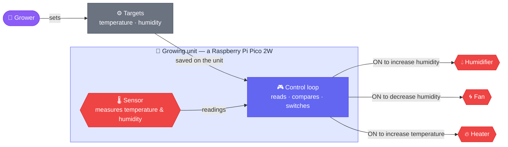
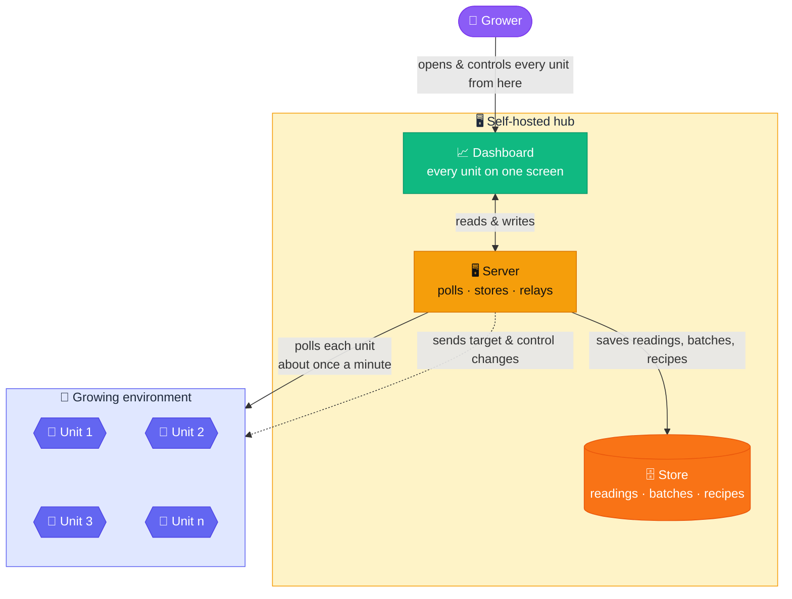

Mushroom Pi is an open-source automated grow controller. At its heart is a Raspberry Pi Pico 2W that reads a temperature and humidity sensor and drives a humidifier, a fan, and a heater to hold your targets — and it does all of that entirely on its own, with no server, no dashboard, and no internet. The hub is what you add when you want more, not something the system depends on to work.

## The growing unit

*A growing unit reads its sensor and switches three devices to hold the temperature and humidity you set — entirely on its own.*

One unit is the whole product for a single grow space. It reads its sensor on its own loop, switches the humidifier, the fan and the heater toward the targets you set, and never needs a server, a dashboard or the internet to do any of it. For the full picture — what it senses, what it switches, how it decides, and how it behaves with no network — read [What a growing unit is](/pico-units/what-a-unit-is).

## The hub

*Several units report to one self-hosted hub, which saves their readings and gives you one place to control them all — while each unit keeps regulating on its own.*

The hub is what you add on top, never something a unit depends on. It polls each unit about once a minute, saves every reading, and gives you a single dashboard for all of your units — plus batches and recipes. Changing a target from the dashboard sends it to the unit, which applies it and keeps regulating on its own. For the full picture — which units it shows, what it stores, and what it does not do — read [What the dashboard is](/dashboard/what-the-dashboard-is).

## The three ways of working

Mushroom Pi works the same way at its core in every setup: a Pico unit reads its sensor and drives its relays against the targets it holds. What changes is where you look at it.

1. **Just the unit, no Wi-Fi.** A freshly built unit with no network still regulates — it runs its own open Wi-Fi access point, and you reach its page on any phone or laptop to read the climate and change the targets.
2. **The unit on your Wi-Fi.** Join the unit to your home network and reach its page at a normal address. Still no server, no hub, no internet — the unit regulates and serves its own page all by itself.
3. **Units plus a self-hosted hub.** Add the hub when you want a dashboard for several units, reading history, and batches and recipes. The hub is what you add on top — a unit never depends on it.

The detail — exactly what you get in each mode and what stays hub-only — is on [How a Pico unit runs](/pico-units/index).

## What every unit does

- **Environmental control** — a relay-based control loop runs on the unit, holding temperature and humidity near your targets. The hub is never in the control path.
- **Its own page** — every unit serves a page showing live readings, relay states, and controls, reachable with no hub, no sign-in, and no internet.
- **Settings that stick** — the targets and the control-loop switch are saved on the unit, so they survive a power cut and are restored on the next boot.
- **Offline operation** — with no Wi-Fi at all, the unit runs its own open access point and keeps regulating; you reach it from any phone or laptop.

## What the hub adds

- **Dashboard** — see several units side by side and manage them from one screen.
- **Reading history** — the hub stores every reading and charts it over time.
- **Batches and recipes** — track cultivation runs and reuse environment settings.
- **Self-hosted** — everything runs on your own hardware, with no cloud account and no subscription. To reach the dashboard away from home you set up Tailscale yourself; the [remote-access guide](/deployment/remote-access) covers it.

Open source throughout: firmware, server, dashboard, mock and ops tooling are all published on GitHub under an open licence.

See the [Hub dashboard](/dashboard/index) guide for the full walkthrough, and [System overview](/system-overview) for how the pieces fit together.

## How it works

Power on a unit and it reads its sensor on its own loop, drives the relays toward the targets you last set, and serves its own page. No network and no hub are involved — this is the whole product for a single grow space.

If you run a hub, the unit announces itself to it, the hub polls the unit every 60 seconds and stores each reading, and the dashboard reflects them. Changing a target from the dashboard sends it to the unit, which applies it and keeps regulating on its own.

## Next steps

- [Quickstart](/quickstart) — run your first unit (and, optionally, the hub).
- [System overview](/system-overview) — how the firmware, server, and dashboard fit together.
- [How a Pico unit runs](/pico-units/index) — the three ways of working, in full.
- [What a growing unit is](/pico-units/what-a-unit-is) — the unit in pictures and plain language.
- [What the dashboard is](/dashboard/what-the-dashboard-is) — the hub's dashboard in plain language.
