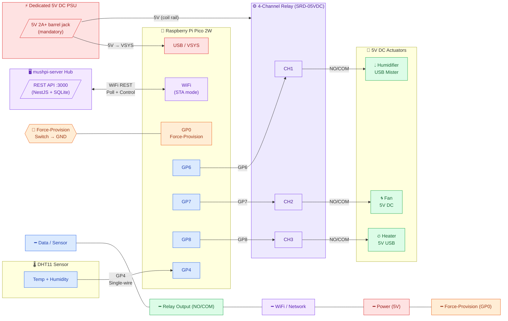

This page is the hardware reference for one Mushroom Pi grow unit. It lists what the **tested build** actually uses — labelled honestly as a reference implementation, not a mandatory shopping list — and, alongside it, what each part has to be able to do. A grower can substitute any equivalent part that meets the capability requirements without being told ours are the only ones that work.

## System orientation

The diagram orients the parts before you buy them. The **hub** — `mushpi-server` running in Docker on any single-board computer — talks to each unit over Wi-Fi, polling readings and sending control commands. Inside the unit, a **Raspberry Pi Pico 2W** reads the **DHT11 sensor** on one GPIO pin and drives a **relay module** on three more. The relay module switches the three **5 V actuators** — humidifier, fan, and heater — on the 5 V rail, and a **dedicated 5 V supply** powers both the relay module and the Pico. A **force-provision switch** on GP0 is the only other input. The pin-level wiring is on the [Wiring](/pico-units/wiring) page.

## Reference implementation (the tested build)

| Part | Model / variant | Notes |
|---|---|---|
| Microcontroller | Raspberry Pi Pico 2W | RP2350, dual-core, built-in Wi-Fi |
| Temperature & humidity sensor | DHT11 (4-pin module) | Single-wire digital; chequered accuracy |
| Relay module | 4-channel 5 V relay (SRD-05VDC) | Channels 1–3 used; 1 channel spare; active-low by default; optocoupler-isolated |
| Humidifier | Ultrasonic mist maker (USB-powered) | Switched by relay channel 1 |
| Fan | 30×30×10 mm 5 V DC brushless | Switched by relay channel 2; air circulation |
| Heater | Low-wattage USB heating mat (5 V) | Switched by relay channel 3 |
| Power supply | 5 V / 2 A+ DC (barrel jack) | Dedicated to the relay module and actuators — not run through the Pico's USB port |

The relay module has **four channels; only three are used** (humidifier = channel 1, fan = channel 2, heater = channel 3). The remaining channel stays spare.

## Photographs of the reference build

[![Top-down photograph of the Mushroom Pi reference prototype assembled on a white solderless breadboard resting on the dark textured USB heating mat, with six colour-coded bounding boxes and word labels calling out the Heating mat (orange box framing the dark pad beneath the build), Raspberry Pi Pico 2W (red box on the left of the breadboard), Fan (blue box standing upright at center-left), Temperature and humidity sensor (green box at center showing a blue 4-pin DHT11 with a pull-up resistor), Humidifier (cyan box at upper right showing the black ultrasonic mist head, white cotton wick rod, and green USB driver board), and Relay (magenta box at lower right showing the blue SRD-05VDC relay module and screw terminals).](/assets/pics/prototype-annotated.png)](/assets/pics/prototype-annotated.png)

**Tested reference build on a breadboard** (select the photograph to open the full-resolution image). This photograph shows the maintainer's working prototype rather than a required physical layout — any equivalent parts that meet the [capability requirements](#capability-requirements-what-you-may-substitute) below work the same way. The owner's pre-annotated call-out on the outer orange box reads **`Heating mat`**, which corresponds to the **Heater** part in the system diagram, prose, and reference table above (a low-wattage 5 V USB heating mat lying flat beneath the breadboard and relay module).

**Power arrangement note:** The photographed build is a **USB-powered prototype** where power enters through individual USB cables (visible on the left edge of the Pico 2W and the right edge of the humidifier driver board), and the 5 V power supply itself is outside the frame. While powering the Pico 2W over either USB or `VSYS` is supported, the pictured USB-cable distribution is **not** the recommended power distribution arrangement for a full unit: the recommended build powers the relay module and actuators from a **dedicated 5 V / 2 A+ DC power supply** as shown in the diagram above and detailed on the [Power](/pico-units/power) page.

Each colour-coded word label in the photograph matches a row in the [Reference implementation](#reference-implementation-the-tested-build) table by name:

- **`Raspberry Pi Pico 2W`** *(red box, left of breadboard)* → **Microcontroller** (`Raspberry Pi Pico 2W`)
- **`Temperature and humidity sensor`** *(green box, center of breadboard — blue 4-pin DHT11 with pull-up resistor)* → **Temperature & humidity sensor** (`DHT11`)
- **`Relay`** *(magenta box, lower right — blue `SRD-05VDC` relay module with screw terminals, leftmost relay marked `HEATER`)* → **Relay module** (`SRD-05VDC`)
- **`Humidifier`** *(cyan box, upper right — black ultrasonic transducer cap, white cotton wick rod, and green USB driver board)* → **Humidifier** (`Ultrasonic mist maker (USB-powered)`)
- **`Fan`** *(blue box, lower center-left — upright black square fan on the breadboard)* → **Fan** (`30×30×10 mm 5 V DC brushless`)
- **`Heating mat`** *(orange box, outer border — dark textured pad beneath the breadboard and relay board)* → **Heater** (`Low-wattage USB heating mat (5 V)`)

## Capability requirements (what you may substitute)

Each role only needs to meet these requirements — the specific part above is what the maintainer happens to test, not what you must buy.

| Role | Requirement |
|---|---|
| Microcontroller | Runs MicroPython, hosts Wi-Fi, and exposes the GPIO pins the firmware needs — the Pico 2W is the tested choice because it has Wi-Fi built in |
| Temperature & humidity sensor | A DHT11-compatible single-wire sensor the firmware can read |
| Switching | Low-voltage DC switching for the actuators, rated for the actuator current — the relay module switches the 5 V rail only, and never carries mains |
| Each actuator (humidifier, fan, heater) | A 5 V DC load that does the environmental work: add moisture, move air, add heat |
| Power supply | A supply with enough current headroom for the full load — see [Power](/pico-units/power) for the load table and why 5 V / 2 A+ is the tested minimum |

All of the Pico-side components are widely available from electronics distributors (Adafruit, SparkFun, Pimoroni, AliExpress, Amazon); search for "Raspberry Pi Pico 2W", "DHT11 module", and "5V 4-channel relay module".

## Server host

The hub runs the backend and dashboard in a single container. You need one host on your local network to run it.

| Part | Qty | Notes |
|---|---|---|
| Docker-capable SBC or Linux host | 1 | Any Docker-capable single-board computer — the Raspberry Pi 3 Model B v1.2 (with a 64-bit OS) is the tested bare-minimum reference |
| microSD card — 16 GB or larger | 1 | Stores the OS, container image, and SQLite database |
| Power supply for the host | 1 | e.g. the official Raspberry Pi 3 PSU (5 V / 2.5 A micro-USB) for a Raspberry Pi 3 Model B |
| Ethernet or 2.4 GHz Wi-Fi | — | The hub must be reachable on the same network as the Pico units |

## Optional components

| Component | Notes |
|---|---|
| Half-size or full-size breadboard | Useful for prototyping before soldering or using an enclosure |
| Pin headers for Pico | Pre-soldered on some variants; required if yours is headerless |
| Enclosure / project box | Protects the electronics in a real grow environment |

## Server hosting alternatives

The container image (`ghcr.io/mushroom-pi/mushpi-hub`) runs on any Linux host with Docker installed — an existing home server, a NUC, or a cloud VM all work. The Pico units reach the server over your local network (or via Tailscale for remote access), so the host only needs a stable address on the same network as the Pico units.
