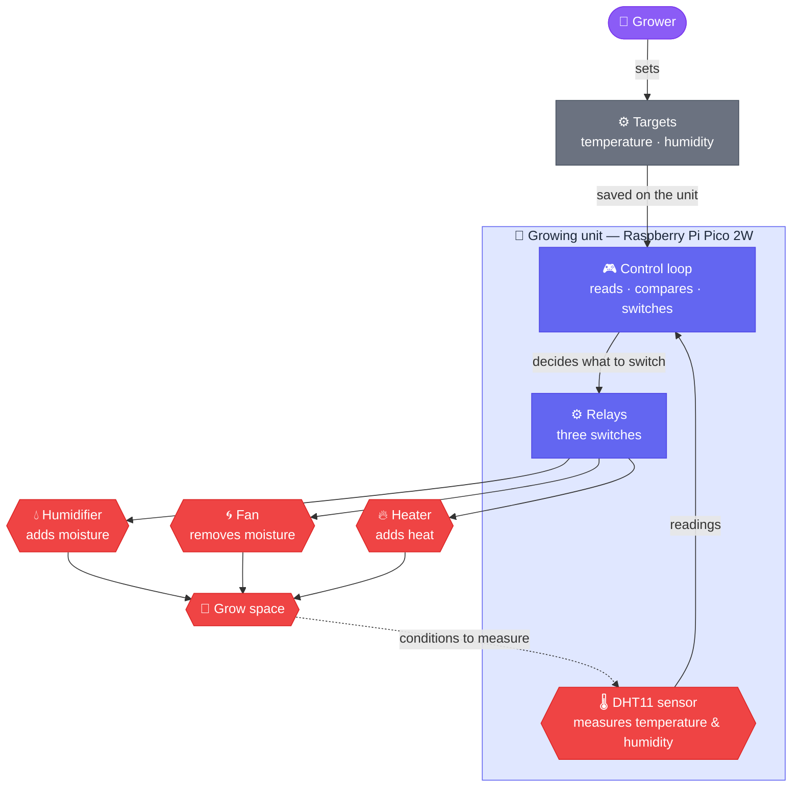

A **growing unit** is a self-contained climate controller that sits in one grow space. It reads the temperature and humidity from a single sensor, switches a humidifier, a fan and a heater toward the targets you set, and makes every one of those decisions itself, on its own loop, with no server, no dashboard and no internet. This page is the mental model; the walkthrough of the three ways a unit runs is [How a unit runs](/pico-units/index), and the exact switching numbers are on [How the control loop works](/pico-units/hysteresis-control).

*The loop a unit runs: sense, compare, switch — then the grow space changes and it senses again. All of it happens on the unit.*

## What it senses

One sensor reads two numbers — **temperature** and **relative humidity** — and it reads them together. In the tested build that sensor is a **DHT11**, a single-wire part, but the firmware only needs a DHT11-compatible sensor it can read. Those two readings feed everything else: the control loop uses them to decide what to switch, and the unit's own page shows them live. Which part to buy and how to wire it is on [Components](/pico-units/components) and [Wiring](/pico-units/wiring).

## What it switches

The unit switches three devices, one job each:

- The **humidifier** adds moisture to the air.
- The **fan** moves air, which removes moisture.
- The **heater** adds heat — and it is the only heat source. Nothing on the unit cools, so temperature is held from below: the heater stops it falling, and any rise is left to the grow space.

In the tested build the three devices are switched through a relay module — humidifier on channel 1, fan on channel 2, heater on channel 3. The pin-level detail is on [Wiring](/pico-units/wiring), and the parts on [Components](/pico-units/components).

## How it decides

The deciding is a **control loop** that runs on the unit and re-evaluates on its own rhythm. Each pass it reads the sensor, compares the readings against the targets you set, and switches devices toward them. It does not hold the targets exactly — it holds them *close*, with a comfortable margin either side so the devices switch cleanly instead of flickering on and off at the target line. The humidifier and the fan act on opposite sides of the humidity target, and the loop never runs both at once.

How close is close, how long a device must stay on, and the loop's exact rhythm are tuning values saved on the unit — the numbers and what they mean are on [How the control loop works](/pico-units/hysteresis-control), and this page deliberately does not repeat them.

## What you set

Two things are yours to change, and they are the same from the unit's own page or from the dashboard:

- **Target temperature** (whole degrees) and **Target humidity** (whole percent).
- The **control loop on/off switch**.

These are saved on the unit itself, so they survive a power cut and come back on the next boot. With the loop **off** you can switch the three devices by hand; the one exception is that the **heater always comes back off** after a restart, for safety — there is nothing on the unit that can cool, so a heater that returned on would be an unattended heat source. The full "what survives a restart" list is on [Pico firmware](/pico-units/firmware#what-survives-a-restart).

## With no network and no hub

A unit needs no network and no hub to do its job. With no Wi-Fi it runs its own open access point, keeps regulating, and keeps serving its own page — you join that network from any phone or laptop to read the climate and change the targets. The hub is never in the control path: nothing the hub does — or fails to do — can stop a unit from regulating. The details are on [Offline operation](/pico-units/offline-operation).

One honest caveat: the loop needs a plausible reading to act on, and a failed sensor is **not** fail-safe. The unit keeps regulating on the last good reading it saw, and it cannot tell a broken sensor from a working one — so the devices may keep switching on a now-stale number. That is explained fully in [How the control loop works](/pico-units/hysteresis-control#sensor-faults-are-not-fail-safe).

## What a unit is not

A unit on its own has no reading history, no batches and no recipes — those are what the hub adds, and a unit never needs them to keep growing. Read [What the dashboard is](/dashboard/what-the-dashboard-is) for that half of the system.

## Where to go next

- [How a unit runs](/pico-units/index) — the three ways of working, in full.
- [The unit's own page](/pico-units/unit-page) — the page every unit serves, with live readings and controls.
- [Offline operation](/pico-units/offline-operation) — the unit's own access point.
- [How the control loop works](/pico-units/hysteresis-control) — the tuning values and what they do.
- [Components](/pico-units/components) and [Wiring](/pico-units/wiring) — the parts and pins to build one.
