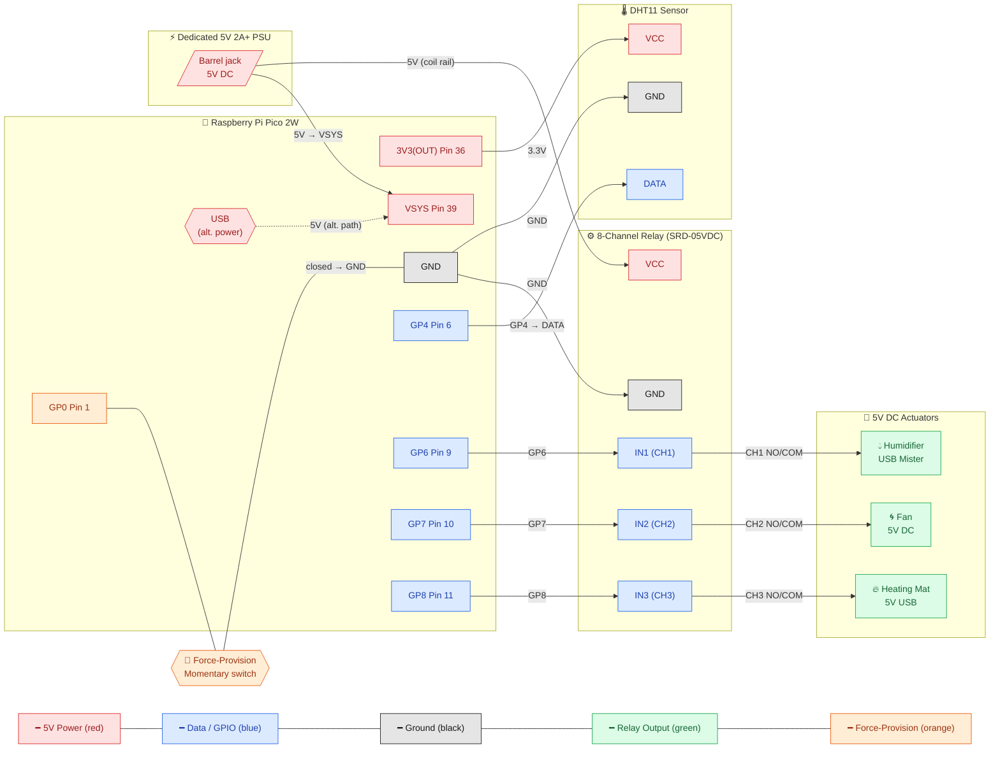

The pin map on this page is a **set of defaults, not a fixed wiring**. The firmware ships with the DHT11 on **GP4** and the relays on **GP6 / GP7 / GP8**, and those assignments are configurable — you can change them in `config.json` (see [Changing the pin assignments](#changing-the-pin-assignments)). The defaults are documented first, then how to change them.

> **No mains voltage.** Every part in this build runs on 5 V DC or 3.3 V DC. The relay module switches the low-voltage side only — there is no 110 V / 230 V mains anywhere in the unit. Never connect mains to the relay module.

## Wiring overview



The diagram shows the four kinds of connection, colour-coded by signal — **data/GPIO** (blue), **5 V power** (red), **ground** (black), **relay outputs** (green), and the **force-provision** input (orange):

- The Pico's **GP4** carries the DHT11's single-wire data line; **GP6, GP7 and GP8** drive the relay inputs IN1, IN2 and IN3 (humidifier, fan, heater).
- The **dedicated 5 V supply** feeds both the relay module's coil rail and the Pico's VSYS pin (39); the Pico's 3V3(OUT) pin powers only the DHT11, not the relays. USB is shown as an alternative power path for the Pico.
- All devices share a common **ground**.
- The relay channels switch the three actuators on the **5 V rail** — each relay's NO/COM contact pair sits between the 5 V supply and its actuator, not between the Pico and the actuator.
- The **force-provision switch** is a momentary switch from GP0 to ground; closing it at boot pulls GP0 low and arms offline (AP) mode.

## Wiring steps

### 1. Connect the DHT11 sensor

The DHT11 has three pins (some breakout modules add a fourth pull-up-resistor pin — check your board's silkscreen):

- **VCC → Pico pin 36 (3V3 OUT)** — 3.3 V power for the sensor
- **GND → any Pico GND pin** (e.g. pin 38)
- **DATA → GPIO 4 (pin 6)** — the firmware default; the internal pull-up is used

If your DHT11 is a bare component rather than a module, add a 10 kΩ pull-up resistor between DATA and VCC.

### 2. Connect the relay module

Most 5 V relay modules accept 3.3 V logic signals from the Pico's GPIO pins:

- **VCC → the dedicated external 5 V supply** — the module's coils are 5 V components (~70 mA per active channel) and must not draw from the Pico's 3.3 V regulator
- **GND → any Pico GND pin** (common ground with the 5 V supply)
- **IN1 (humidifier relay) → GPIO 6 (pin 9)** — firmware default
- **IN2 (fan relay) → GPIO 7 (pin 10)** — firmware default
- **IN3 (heater relay) → GPIO 8 (pin 11)** — firmware default

Most relay modules are **active-low**: the relay energises when the GPIO is pulled LOW. The firmware defaults to this (`active_high: false` in `config.json`); verify that your module matches.

### 3. Connect the actuators to the relay contacts

Each actuator is switched on the 5 V rail by its relay's normally-open (NO) and common (COM) contacts — the relay sits between the 5 V supply and the actuator, so the actuator only receives power when its relay is energised:

- **Humidifier** — channel 1 (NO1/COM1)
- **Fan** — channel 2 (NO2/COM2)
- **Heating mat** — channel 3 (NO3/COM3)

For the USB-powered actuators (humidifier, heating mat), the 5 V line of the USB cable is cut and interrupted by the relay's NO/COM pair; the ground passes through. The fan is a bare 5 V DC motor wired the same way. All three remain 5 V DC — no part of an actuator connects to mains.

### 4. Connect the force-provision switch

A **momentary switch between GP0 (pin 1) and GND** arms offline (AP) mode: hold it closed during boot to force the unit into its access-point setup flow, even when Wi-Fi credentials are already configured. GP0 has an internal pull-up (33 kΩ–60 kΩ), so the switch alone is enough — closing it pulls the pin low. The full flow is on the [Offline operation](/pico-units/offline-operation) page.

### 5. Connect the dedicated 5 V supply

Power the relay module's VCC and the actuator circuits from a **dedicated 5 V / 2 A+ DC supply** — their combined draw exceeds what the Pico's USB port can provide, so the supply is mandatory and is not run through the Pico's USB port. The Pico itself can be powered via USB or its VSYS pin (39). During development you can power the Pico from your computer's USB port and use the same cable for flashing and serial-console access. The supply requirement and load table are on the [Power](/pico-units/power) page.

## Pin mapping reference (defaults)

| Component | Pico physical pin | GPIO | Notes |
|---|---|---|---|
| Force-provision input | 1 | GP0 | Internal pull-up; held LOW at boot to force AP provisioning |
| DHT11 VCC | 36 | — | 3V3 OUT rail |
| DHT11 GND | 38 | — | Any GND pin works |
| DHT11 DATA | 6 | GP4 | Firmware default; internal pull-up used |
| Relay VCC | — | — | External 5 V from the dedicated supply — never the Pico's 3V3 pin |
| Relay GND | 38 | — | Common ground — any GND pin works |
| Relay IN1 — humidifier | 9 | GP6 | Active-low by default |
| Relay IN2 — fan | 10 | GP7 | Active-low by default |
| Relay IN3 — heater | 11 | GP8 | Active-low by default |

## Changing the pin assignments

The four GPIO numbers above live in `config.json` on the unit, under the `pins` key:

```json
"pins": { "dht": 4, "humidifier": 6, "fan": 7, "heater": 8 }
```

Edit these values (then redeploy `config.json`) to move a device to a different pin, and keep your physical wiring in step — each of the four roles needs a **distinct** GPIO, checked at boot against the *effective* map (the `pins` you write plus the defaults left in place, so a partial object like `"pins": { "humidifier": 4 }` collides with the default `dht: 4`).

- `active_high` (a sibling key) flips relay polarity; `false` is active-low, the default.

The pin map can also be changed at runtime via the unit's `POST /setup` endpoint, which persists to `config.json` so the change survives a reboot.

### GPIO validation

Pin assignments are validated in two **separate** places, by two **different** rule sets. They are not the same check, and confusing them hides real behaviour.

#### The live / request-merged rule

This is the rule set that governs changing pins while the unit is running. It applies identically in four places: the unit page's **PIN mapping** card, a direct `POST /setup` to the unit, the hub's `PUT /v1/pico-units/:id/control/setup` proxy, and the mock (which mirrors the firmware for development).

- **Valid pins:** the integers **GP1–GP22, GP26, GP27, GP28**.
- **Reserved, refused with a named reason:** **GP0** — the force-provision jumper, sampled at every boot — and **GP23, GP24, GP25, GP29** — the CYW43439 wireless chip.
- **Duplicates are a merged-view rule.** The pins in your request are overlaid on the unit's current mapping and the combined result is checked, so a conflict with a pin the unit already holds is caught, not just two pins inside one request. Re-assigning a device to the pin it already holds is allowed (an idempotent re-send); a pin freed by another device *within the same request* is allowed (a swap). Only a conflict the request creates or keeps alive is refused, naming the pin and its holder — `GPIO 6 is already assigned to the humidifier`.

The hub returns **422** for a rejected change; the firmware and the mock return **400**. The rule set is deliberately the same across all three layers — the duplication is on purpose, not an accident.

One divergence worth knowing: the hub's valid-pin list currently **includes GP0**, while the unit **reserves** it. A GP0 change sent through the hub therefore passes the hub's own check, is forwarded, and is then refused by the unit. The two layers currently disagree on GP0; this is known, and it means the hub's pre-check is not a guarantee the unit will accept a change.

#### The boot rule — separate, stricter, terminal

Independent of the request-scoped rule above, the firmware validates `config.json` once at boot, and the check is **stricter and terminal**. Any two roles that share a GPIO in the **effective** `pins` map — the `config.json` `pins` object shallow-merged over the built-in defaults — is a fatal config-validation error. The unit prints the colliding pair (`ERROR: GPIO 6 is assigned to both pins.humidifier and pins.heater — each device needs a distinct GPIO`), enters the repeating **CONFIG ERROR** blink state (see [Status indicators](/pico-units/status-indicators)) and starts no services. There is no in-place fix and no degraded mode: correction means redeploying a corrected `config.json`. This rule is firmware-only — the mock has no boot-time config validation — and it is deliberately **not** folded into the request-merged rule above.

Direct calls to the unit bypass only the hub's own pre-check. The firmware enforces the same reserved-pin and merged-view rules itself, returning **400** with a message that drops the article the hub keeps — `GPIO 6 is already assigned to humidifier`, not `the humidifier`. There is no clamping and no fallback: a reserved pin is refused with its named reason, exactly as on the page.

## After wiring

Once all the connections are secure, flash the MicroPython firmware — see [Pico Firmware](/pico-units/firmware). After a successful boot the Pico exposes its REST API on **port 5000**; you can confirm it is reachable from any device on the same network at `http://<pico-ip>:5000/health`.
