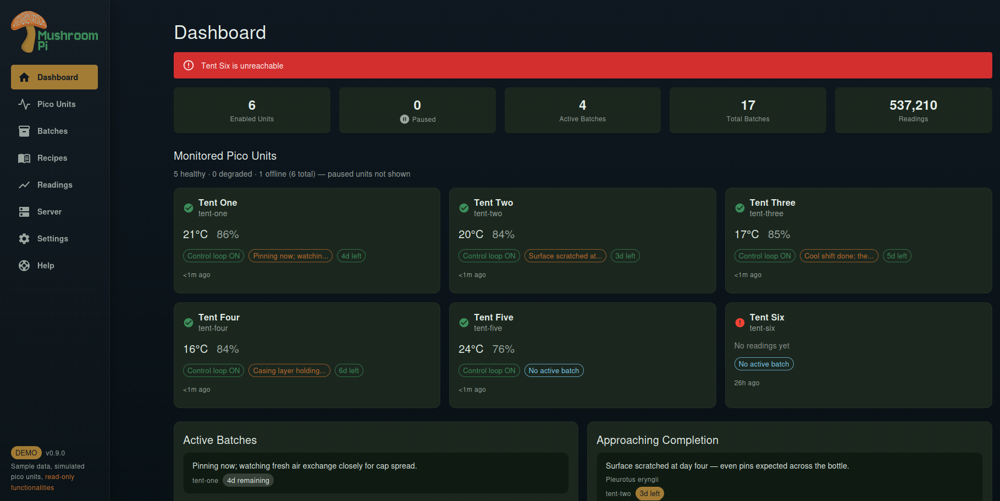

The Mushroom Pi demo is a public, **read-only**, **populated** instance of the hub running against **simulated** units. Open it at [https://mushroom-pi.demo.amda.dev/](https://mushroom-pi.demo.amda.dev/). It is there so you can see the dashboard, charts, batches and recipes working before you build anything — but it is **not a real grow**, nothing in it controls any real equipment, and it should not inform real grow decisions.

It is hosted by the maintainers, and it may change or go away at any time.

## What you'll see

The demo runs six simulated units:

- **Five live units** — four healthy, and one whose readings drift so you can see a sensor wandering away from its target.
- **One offline unit** — it reads as offline in the dashboard, but it is not really running anywhere; there is no hardware behind it.

The dashboard, charts, batches and recipes are all populated with realistic data so the system looks like it is mid-run.

## What's simulated

Everything you see is simulated or sample data:

- Every unit, reading, chart, batch and recipe is generated, not measured.
- The recipe catalogue and the readings history are **sample data, not what a real hub ships with** — a self-hosted hub starts with no pre-loaded recipes and no history.
- Nothing controls any relay. There is no humidifier, fan or heater anywhere in the loop.

Because nothing here is real, do not use the demo to judge conditions for a real grow.

## What you can (and can't) do

The demo is read-only for visitors. You cannot create, edit or delete anything — units, batches, recipes, images or settings. Any attempt to change something is refused and nothing is saved.

The demo also paces how quickly you can browse and how often you can try to make changes, so no single visitor can overload it. If you click faster than that pace, it simply asks you to slow down.

One thing you can change freely is the **display timezone** — the zone the dashboard shows times in. That choice is kept only in your own browser, so it affects nobody else and never touches the server.

## It resets nightly

The demo resets **nightly** to a fresh, populated state. That reset removes any changes visitors made during the day, and the demo comes back looking the same each morning.

## Run your own

The demo is a hosted showcase; it is not the only way to see Mushroom Pi. To run the full system on your own hardware, see [Self-hosting](/deployment/self-hosting).

How this demo instance is operated is covered on the [Demo environment](/demo-environment) page.

## Recipe credits

The demo's recipe catalogue is researched, not invented: every recipe is drawn from a published cultivation source, and each recipe's photo is from Wikimedia Commons. The guidance is adapted from the sources below, which state no licence of their own, so the guidance is attributed here without a licence claim — the licence column refers to each recipe's photograph.

| Recipe | Species | Source | Photo licence |
| --- | --- | --- | --- |
| Grey Oyster on Straw | *Pleurotus ostreatus* | [D.I.Y. FunGuide: Grow Your Own Oyster Mushrooms at Home (UF/IFAS SS662)](https://ask.ifas.ufl.edu/publication/SS662) | CC BY-SA 4.0 |
| Shiitake on Sawdust Blocks | *Lentinula edodes* | [Shiitake Mushroom Production: Fruiting, Harvesting, and Storage (Ohio State University Extension)](https://cfaes.osu.edu/fact-sheet/shiitake-mushroom-production-fruiting-harvesting-and-storage) | Public domain |
| Lion's Mane on Hardwood | *Hericium erinaceus* | [Introduction to Fruiting (Redwood Mushroom Supply)](https://www.redwoodmushroomsupply.com/blogs/news/introduction-to-fruiting) | CC0 |
| Reishi Antler/Conk | *Ganoderma lucidum* | [How To Grow Reishi Mushrooms (Redwood Mushroom Supply)](https://www.redwoodmushroomsupply.com/blogs/mushroom-cultivation/how-to-grow-reishi-mushrooms) | CC BY 4.0 |
| Enoki in Bottles | *Flammulina filiformis* | [How to Grow Enoki Mushrooms at Home (Mushroom Grow Lab)](https://mushroomgrowlab.com/species/enoki) | CC BY 4.0 |
| King Trumpet on Masters Mix | *Pleurotus eryngii* | [Mushroom Production (Irish Gourmet Mushrooms)](https://www.irishgourmetmushrooms.ie/mushroom-production) | CC0 |
| Pioppino on Supplemented Sawdust | *Agrocybe aegerita* | [How To Grow Pioppino Mushrooms (Redwood Mushroom Supply)](https://www.redwoodmushroomsupply.com/blogs/mushroom-cultivation/how-to-grow-pioppino-mushrooms) | CC BY-SA 3.0 |
| Chestnut on Sawdust | *Pholiota adiposa* | [Chestnut — Pholiota adiposa (Mushroom Mountain)](http://mushroommountain.com/chestnut-fungus-pholiota-adiposa) | CC0 |
| Pink Oyster on Pasteurized Straw | *Pleurotus djamor* | [Pink Oyster — Pleurotus djamor (Mushroom Mountain)](https://mushroommountain.com/pink-oyster-pleurotus-djamor-main) | CC BY-SA 3.0 |
| Maitake on Hardwood Blocks | *Grifola frondosa* | [Grifola frondosa cultivation guide (Unicorn Bags)](https://unicornbags.com/cultivation/grifola-frondosa) | Public domain |
| Buna-shimeji in Bottles | *Hypsizygus tessellatus* | [The Complete Guide to Shimeji Mushrooms (GroCycle)](https://grocycle.com/shimeji-mushrooms) | CC0 |
| Paddy Straw Mushroom in Beds | *Volvariella volvacea* | [How to Grow Paddy Straw Mushroom (Volvariella volvacea)](https://mushroomalmanac.com/mushrooms/paddy-straw) | Public domain |
| Button Mushroom on Compost | *Agaricus bisporus* | [Basic Procedures for Agaricus Mushroom Growing (Penn State Extension)](https://extension.psu.edu/basic-procedures-for-agaricus-mushroom-growing) | CC BY-SA 4.0 |
| Turkey Tail on Sawdust Blocks | *Trametes versicolor* | [How to Grow Turkey Tail Mushrooms: A Canadian Cultivation Guide (Nature Lion)](https://naturelion.ca/blog/how-to-grow-turkey-tail-mushrooms) | CC BY 4.0 |
